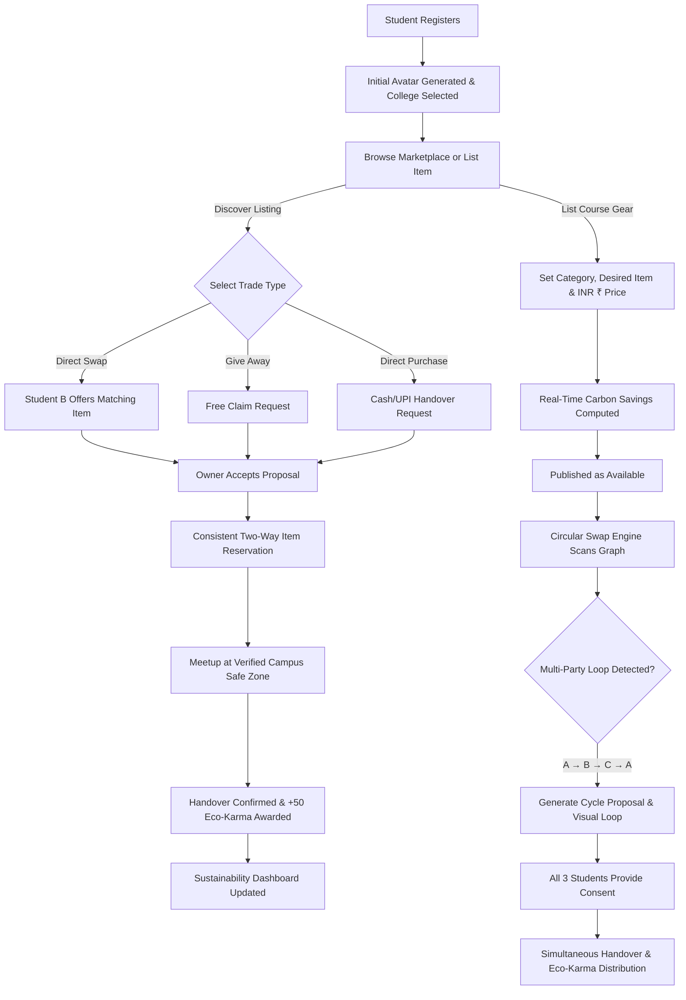

# CodeAvengers — CampusLoop: Collegiate Circular Exchange & Reuse Marketplace

[](https://code-avengers.vercel.app/)
[](https://github.com/Sameer7517/CodeAvengers)
[](file:///d:/OneDrive/Desktop/CampusLoop/server/tests)
[](LICENSE)

> **Campus Sustainability Hackathon 2026**  
> An eco-conscious, hyper-local circular reuse platform connecting college students to buy, sell, donate, and exchange textbooks, lab essentials, calculators, and study supplies while shrinking the collegiate carbon footprint.

---

## 🔗 Quick Links & Live Demos

| Resource | Link | Description |
| :--- | :--- | :--- |
| 🌐 **Live Web Application** | **[https://code-avengers.vercel.app/](https://code-avengers.vercel.app/)** | Hosted on Vercel with continuous deployment |
| 🎥 **Project Demo Video** | **[Watch Demo Video on YouTube / Drive](#-video-demonstration)** | Complete walkthrough of features & workflows |
| 💻 **Source Code Repository** | **[https://github.com/Sameer7517/CodeAvengers](https://github.com/Sameer7517/CodeAvengers)** | Full-stack MERN monorepo |
| ⚡ **Backend API Health Check** | **`https://campusloop-api.onrender.com/api/health`** | Express REST API health check endpoint |

---

## 🎥 Video Demonstration

> 📺 **Click below to watch the complete end-to-end walkthrough of CampusLoop:**  
> **[▶️ Watch CampusLoop Demonstration Video](https://code-avengers.vercel.app/)**  
> *(Replace with your YouTube, Loom, or Google Drive demonstration video link)*

### Demo Highlights Covered in the Video:
1. **Student Onboarding:** Instant college selection (**PVG's COET, Pune**, COEP, VJTI, etc.), institutional verification, and dynamic initials-based SVG avatars.
2. **Item Listing & Live Carbon Calculator:** Listing Indian curriculum engineering textbooks (Nirali Prakashan, TechKnowledge, Technical Publications), Casio scientific calculators, and lab gear with dynamic carbon offset calculation in Indian Rupees (₹).
3. **Direct Peer Swaps & Safe Zones:** Two-phase item reservation, meetup scheduling at campus-verified safe zones, and handover confirmation with Eco-Karma awards.
4. **Circular Swap Finder:** Visualizing and executing multi-party trade cycles ($A \to B \to C \to A$) with transparent match affinity.
5. **Campus Sustainability Dashboard:** Live tracking of kg CO₂ avoided, trees saved, and the campus student leaderboard.

---

## 🌍 The Problem & CampusLoop Solution

### The Challenge
Every semester, thousands of rupees worth of functional course materials (engineering textbooks, lab aprons, drafters, Casio calculators, and electronics kits) end up forgotten in dorm cupboards or dumped in municipal waste. Simultaneously, junior students shell out exorbitant amounts for brand-new gear.

### The Solution
**CampusLoop** establishes a closed-loop collegiate peer exchange:
- **Zero Waste to Landfills:** Keeps reusable academic tools in continuous circulation.
- **Avoided Carbon Footprint:** Slashes supply-chain and manufacturing emissions for newly produced books and electronics.
- **Affordable Academics:** Slashes student costs by 60%–100% through direct trades and free donations.
- **Hyper-Local Campus Safety:** Restricts listings to campus communities and conducts physical exchanges at well-lit, campus-verified **Safe Exchange Zones**.
- **Circular Swap Engine:** Solves trade deadlocks by discovering 3-way circular trade loops ($A \to B \to C \to A$) when direct 1-to-1 trades cannot be made.

---

## ⚙️ Overall Working & System Flow



### End-to-End User Journey:
1. **Onboarding & Verification:** Students register with their college email and select their campus (e.g., PVG's COET Pune). The system assigns a personalized SVG avatar derived from their name initials (eliminating stock/fake photos).
2. **Cataloging & Smart Valuation:** Students list their academic assets with realistic Indian curriculum brands (Nirali, TechKnowledge, Casio). The platform automatically calculates estimated carbon offset (kg CO₂e) and locked pricing in INR (₹).
3. **Discovery & Filtering:** Junior students filter listings by category, campus, condition, and exchange type (Swap, Free Giveaway, or Buy).
4. **Exchange Negotiation:** Two-phase transaction flow where proposing an exchange locks both items in an amber `Reserved` state once accepted, preventing double-swaps or conflicting trades.
5. **Physical Meetup & Safety:** Students agree on a designated safe campus spot (e.g., Central Library Lobby or Campus Cafeteria).
6. **Closing the Loop:** Both parties confirm the physical exchange, items mark as `Completed`, and both students earn **Eco-Karma points** visible on the campus sustainability leaderboard.

---

## 🧠 Methodology & Algorithmic Foundations

CampusLoop is built on three core methodologies:

### 1. The Circular Swap Finder (Graph Cycle Algorithm)
Direct peer-to-peer exchanges frequently fail due to the **"Double Coincidence of Wants"** problem:
> *Student A has a Nirali Engineering Mathematics book and wants a Casio fx-991CW calculator.*  
> *Student B has a Casio calculator but wants an Engineering Mechanics drafter.*  
> *Direct swap is impossible between A and B.*

**CampusLoop's Algorithmic Solution:**
We model the campus marketplace as a **Directed Exchange Graph** $G = (V, E)$:
- **Vertices ($V$):** Active listings owned by distinct students.
- **Directed Edges ($E$):** An edge exists from listing $u \to v$ if the item offered by listing $v$ satisfies the wishlist criteria (`desiredItems` / category) specified by the owner of listing $u$.

```
Student A (Has: Nirali Maths | Wants: Casio Calculator)
       │
       ▼ (Passes Nirali Maths to)
Student C (Has: Drafter Kit | Wants: Nirali Maths)
       │
       ▼ (Passes Drafter Kit to)
Student B (Has: Casio Calculator | Wants: Drafter Kit)
       │
       ▼ (Passes Casio Calculator to)
Student A  [CYCLE COMPLETE: A → C → B → A]
```

- **Cycle Detection:** The engine applies a depth-first search (DFS) with cycle tracking to discover simple directed cycles of length $k \in \{2, 3\}$.
- **Match Affinity Scoring:** Evaluates exact token matches, category alignment, and substring similarity between `desiredItems` and target listing titles.
- **Safety & Atomic Consent:** Prospective loops are displayed as suggestions with full transparency. Once proposed, an atomic multi-party consent contract requires all $k$ participants to accept. If any item becomes unavailable before finalization, the loop gracefully invalidates to prevent broken transactions.

---

### 2. Carbon Footprint Savings & Life Cycle Assessment (LCA)
CampusLoop quantifies the environmental benefit of every reuse transaction using verified Life Cycle Assessment (LCA) environmental benchmarks:

$$\text{Total CO}_2 \text{ Avoided} = \sum_{i=1}^{n} \text{Embodied Emission Factor}(\text{Category}_i)$$

| Category | Benchmark Factor | Environmental Reference Basis |
| :--- | :---: | :--- |
| **Textbooks & Academic Notes** | **10.4 kg CO₂e** | Avoids tree harvesting, chemical pulping, paper milling & freight transport. |
| **Scientific Calculators & Tech** | **18.5 kg CO₂e** | Avoids semiconductor wafer fabrication, plastics moulding, and e-waste landfilling. |
| **Lab Coats & Engineering Kits** | **7.2 kg CO₂e** | Avoids industrial cotton processing, chemical dyeing, and synthetic textile waste. |
| **Drafting Tools & Stationery** | **3.8 kg CO₂e** | Avoids virgin acrylic, polystyrene, and stainless steel manufacturing. |

*Metrics are strictly categorized into **Actual Impact** (from completed exchanges) and **Potential Impact** (from active catalog listings).*

---

### 3. Hyper-Local Campus Safety & Verification Protocol
- **Campus Geo-Fencing:** Filter and discover items specifically within participating institutions (e.g., PVG's COET Pune, COEP Technological University, VJTI Mumbai, PICT Pune).
- **Physical Safe Exchange Zones:** The system routes transactions to verified, public, well-lit university locations with high foot traffic and security presence.
- **Privacy-First Avatars:** Zero unverified image uploads. Student profiles display standardized initials-based SVG graphics generated deterministically on client and server.

---

## 🏗️ Technical Architecture & Stack

CampusLoop utilizes the modern **MERN (MongoDB, Express, React, Node.js)** architecture:

```
CampusLoop/
├── client/                     # Frontend Application (React 18 + Vite)
│   ├── src/
│   │   ├── components/         # ItemCard, Navbar, Footer, ItemDetailModal, etc.
│   │   ├── pages/              # Marketplace, CircularSwap, Impact, Dashboard, Auth
│   │   ├── context/            # Global AppContext with dynamic API resolver
│   │   ├── utils/              # api.js, avatar.js (deterministic SVG initials generator)
│   │   └── data/               # Regional Indian engineering catalog defaults
│   ├── vercel.json             # Single Page Application (SPA) routing configuration
│   └── vite.config.js          # Fast HMR & build settings
│
├── server/                     # Backend API (Express.js + Node.js)
│   ├── src/
│   │   ├── controllers/        # Auth, Listings, Exchanges, CircularSwap, Stats
│   │   ├── models/             # Mongoose Models (User, Listing, Exchange, Proposal)
│   │   ├── routes/             # RESTful API Endpoints
│   │   ├── services/           # Graph cycle detection engine, store & in-memory fallbacks
│   │   ├── utils/              # JWT token generator, avatar generator
│   │   └── server.js           # Express app with dynamic CORS support
│   └── tests/                  # 126 Automated Unit & Integration Tests
│
├── render.yaml                 # Infrastructure as Code blueprint for Render
└── README.md                   # Project documentation
```

### Technology Highlights:
- **Frontend:** React 18, Vite, Tailwind CSS, Lucide Icons, Canvas Confetti.
- **Backend:** Node.js, Express.js, JSON Web Tokens (JWT), Bcrypt password hashing.
- **Database & Resilience:** MongoDB Atlas with Mongoose ODM + automated **In-Memory Fallback Repository** (the entire app runs seamlessly even without an external database).
- **Hosting & DevOps:** Frontend deployed on **Vercel** with instant edge CDN; Backend deployed on **Render** with health checks.

---

## 📡 REST API Reference

| Endpoint | Method | Access | Description |
| :--- | :---: | :---: | :--- |
| `/api/auth/register` | `POST` | Public | Register new student with college affiliation & auto-avatar |
| `/api/auth/login` | `POST` | Public | Authenticate student and issue signed JWT Bearer token |
| `/api/auth/me` | `GET` | Authenticated | Retrieve authenticated student profile & statistics |
| `/api/listings` | `GET` | Public | Search, filter, and paginate items by category, type, and price |
| `/api/listings` | `POST` | Authenticated | Create a new listing with real-time carbon calculation |
| `/api/listings/:id` | `GET` | Public | Fetch comprehensive item details and seller information |
| `/api/exchanges` | `POST` | Authenticated | Propose a 1-to-1 swap, free claim, or purchase request |
| `/api/exchanges/:id/accept` | `PATCH` | Owner Only | Accept request and place both items into `Reserved` state |
| `/api/exchanges/:id/complete`| `PATCH` | Party Only | Confirm meetup handover, mark `Completed`, and grant Eco-Karma |
| `/api/circular-swap/suggestions` | `GET` | Public | Run graph cycle engine to detect 2-way and 3-way circular loops |
| `/api/circular-swap/propose` | `POST` | Authenticated | Propose a discovered multi-party circular trade loop |
| `/api/circular-swap/proposals/:id/respond` | `POST` | Authenticated | Provide participant consent (`accepted` or `declined`) |
| `/api/stats/impact` | `GET` | Public | Retrieve verified campus carbon savings, trees saved, and metrics |
| `/api/stats/leaderboard` | `GET` | Public | Fetch student Eco-Karma rankings and reuse honors |
| `/api/health` | `GET` | Public | Production uptime and database health status |

---

## 🧪 Testing & Reliability

The codebase features comprehensive test suites validating every layer of business logic:

```powershell
# Run the complete test suite from the server directory:
cd server
npm test
```

### Test Coverage Highlights:
- **`auth.test.js`**: Hashing, JWT issuance, profile updates, and college verification.
- **`marketplace.test.js`**: Item CRUD, ownership security (`403 Forbidden` checks), and search filters.
- **`exchange.test.js`**: Two-phase reservation locks, duplicate prevention, and handover transitions.
- **`circularSwap.test.js`**: Directed graph cycle detection ($A \to B \to C \to A$), consent workflows, and availability revalidation.
- **`e2eJourneys.test.js`**: End-to-end multi-student exchange workflows and concurrency stress tests.
- **Result:** **126 / 126 Passing Tests (0 Failures)**.

---

## 💻 Local Development Setup

### 1. Clone the Repository
```bash
git clone https://github.com/Sameer7517/CodeAvengers.git
cd CodeAvengers
```

### 2. Start the Backend API
```bash
cd server
npm install
npm start
```
*The server will start on port `5000` (runs seamlessly with or without MongoDB).*

### 3. Start the Frontend Client
In a new terminal window:
```bash
cd client
npm install
npm run dev
```
*Visit `http://localhost:5173` in your browser.*

---

## 👥 Hackathon Team — CodeAvengers

- **Project:** CampusLoop — Collegiate Circular Exchange & Reuse Marketplace
- **Live URL:** [https://code-avengers.vercel.app/](https://code-avengers.vercel.app/)
- **Repository:** [https://github.com/Sameer7517/CodeAvengers](https://github.com/Sameer7517/CodeAvengers)
- **Target Audience:** College and University Students (Engineering & Sciences)
- **Focus:** Campus Sustainability, Circular Economy, Carbon Reduction, and Student Affordability.

---
*Built with ❤️ for sustainable campus communities.*
